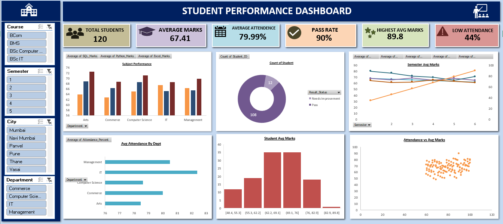

# Student Performance Dashboard | Excel Data Analytics Project

## 📊 Project Overview

This project focuses on analyzing student performance data using Microsoft Excel. The dashboard presents key academic metrics and visual insights in an organized and interactive format to support data-driven analysis.

## 🎯 Project Objectives

- Analyze student academic performance and attendance.
- Summarize important metrics using Key Performance Indicators (KPIs).
- Organize and analyze data using Pivot Tables.
- Present insights through charts and visualizations.
- Build a dashboard that makes student data easier to understand.

## 🛠️ Tools & Techniques

- Microsoft Excel
- Data Cleaning and Data Organization
- Pivot Tables
- Pivot Charts and Data Visualization
- KPI Cards
- Excel Dashboard Design
- Slicers and Interactive Filtering (if implemented)

## 📈 Dashboard Features

- Student performance overview
- Academic metrics and summary KPIs
- Attendance analysis
- Performance comparisons
- Charts and visual summaries
- Interactive filtering (if implemented)

## 🖼️ Dashboard Preview

## 📁 Project Files

- `Sujal's Project.xlsx` — Excel workbook containing the data analysis and dashboard.
- `Student-Dashboard.pdf` — PDF version for quick viewing, if included.
- `dashboard-preview.png` — Dashboard screenshot.

## 💡 Key Learnings

Through this project, I practiced organizing data, summarizing information using Pivot Tables, creating charts, and presenting analytical findings through an Excel dashboard.

## 👨‍💻 Author

Sujal

Data Analyst | Learning Excel, SQL, Power BI and Python

---

If you have suggestions or feedback, feel free to connect with me on LinkedIn.
